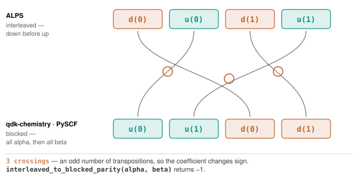

<!--
Copyright (c) 2026 Tobias Wolf
SPDX-License-Identifier: MIT

Adapted from skilledwolf/alpsx (private repository), branch
agent/v3-execution-and-api-audit at d37e51227,
python/qdk-chemistry-alps/docs/conventions.md. Changes: pyalps names
(pyalps.models.to_pauli_operator, compile_observable for observables); the
MPS-container and Q# register sections and the fork history are not carried
over; the RDM checks name this repository's tests.
-->

# Conventions

ALPS and qdk-chemistry each make reasonable, different choices about how to order fermion modes, index qubits, and define a correlation matrix. Every one of these differences is silent when you get it wrong: the code runs, the numbers look plausible, and the physics is subtly incorrect.

This package converts at the boundary so callers do not have to. The sections below say what it converts *between*, so you can check a result independently.

## Fermion mode ordering

**ALPS** stores one site per spatial orbital with four local states (`SpinfulFermion()`: 0 = empty, 1 = up, 2 = down, 3 = up and down), and within each site the down mode comes first: $\lvert\uparrow\downarrow\rangle = c^\dagger_\downarrow c^\dagger_\uparrow\lvert0\rangle$. The global Fock ordering is interleaved:

```
d(0)  u(0)  d(1)  u(1)  ...  d(K-1)  u(K-1)
```

The **qdk-chemistry, MACIS and PySCF determinant interfaces** order all alpha modes before all beta modes:

```
u(0)  u(1)  ...  u(K-1)  d(0)  d(1)  ...  d(K-1)
```



Both orderings describe the same doubly occupied two-orbital state; only the sequence of creation operators differs. Straightening the four wires takes three transpositions, so the coefficient picks up a minus sign. The count depends on the occupation pattern, not just the electron number.

Reordering a string of creation operators between the two conventions costs one transposition per crossing pair, so determinant coefficients differ by a sign. `abinitio.interleaved_to_blocked_parity(alpha_occ, beta_occ)` returns it:

```python
from qdk_chemistry_alps.abinitio import (
    alps_state_to_occupations,
    interleaved_to_blocked_parity,
)

alpha, beta = alps_state_to_occupations(basis_row)
coefficient *= interleaved_to_blocked_parity(alpha, beta)
```

Two consequences worth internalizing: a doubly occupied orbital contributes a sign on its own (the down-before-up site convention), and the sign depends on the *pattern* of occupations, not just their number. `alps_ed` and `alps_classic_dmrg` apply this sign to every CI coefficient they return; the tests pin it against PySCF's FCI vector and MACIS.

## Qubit indexing and Pauli strings

qdk-chemistry Pauli strings are **little-endian**: the rightmost character acts on qubit 0. In a string of length *n*, position *i* acts on qubit *n−1−i*.

For the **spin-½ convenience adapter** (`interop.hamiltonian_to_qubit_operator`), qubit $i$ maps to ALPS site $i$, and Pauli matrices are twice the spin operators: $X=2S^x$. Higher-spin and fermionic exports need the explicit layouts described below.

**On this spin-½ route, dense matrices differ by bit reversal.** QDK Chemistry puts qubit 0 in the least significant bit; pyalps product bases put site 0 in the most significant position. Apply that basis permutation before comparing matrices or states. Other encodings have different maps: use their encoding and state helpers rather than a universal bit-reversal rule. Matching spectra alone cannot establish a correct basis map.

## Spin-orbital ordering in exported qubit operators

`fermionic_hamiltonian_to_qubit_operator` uses **blocked fermion mode order**: modes $0,\ldots,K-1$ are alpha and modes $K,\ldots,2K-1$ are beta, matching QDK Chemistry's mapper. In Jordan–Wigner encoding each qubit stores the corresponding mode occupation. Bravyi–Kitaev and parity encodings instead store combinations of occupations or parities; a qubit is not simply an alpha or beta orbital. The result carries `fermion_mode_order="blocked"` metadata. Use QDK's supported layout conversions, transforming states and observables consistently with the chosen encoding.

`ci_vector_to_qubit_statevector` implements the **blocked Jordan–Wigner occupation map only**. It is not a state converter for Bravyi–Kitaev or parity encodings, or for the native layout below.

For $K$ spatial orbitals there are $2K$ fermionic spin-orbital modes and $4K$ Majorana operators. The `num_modes=2*K` argument to a `MajoranaMapping` factory counts **fermionic modes**, not Majorana operators; for example, use `MajoranaMapping.jordan_wigner(num_modes=2*K)`.

## Direct native Jordan–Wigner export

`pyalps.models.to_pauli_operator` keeps the ordered ALPS local basis and assigns consecutive qubits to sites, with site 0 least significant. Each local basis index is encoded as binary. A spinless site uses one occupation bit. `SpinfulFermion` uses local digits empty/up/down/double = 0/1/2/3, so the up bit precedes the down bit in qubit numbering while the anticommutation mode order remains down before up. `fermion_mode_qubits` records that order explicitly.

`state_index(local_indices)` gives the register index, with the original ALPS amplitude and no additional phase. Export an observable on the same layout with `models.compile_observable(model, observable)` and the operator form `models.to_pauli_operator(op, models.physical_basis(model), ...)`, switching off `require_hermitian`, `require_even` or `require_conservation` as the observable requires. The native compiler preserves the intra-site signs and inter-site Jordan–Wigner strings. No charge sector is projected out; a Hamiltonian with pairing and a stale `N` declaration is rejected.

`interop.pauli_operator_to_qubit_operator` copies the Pauli terms. Keep the pyalps result alongside the QDK container: QDK's blocked/interleaved chemistry metadata cannot encode this layout and is left unset. Do not use the blocked-path `ci_vector_to_qubit_statevector` helper for this route. See the [pairing example](examples/fermion-pairing.md).

## Higher spins and finite local spaces

For the native route, `models.make_qubit_encoding(H, scheme="binary" | "gray")` snapshots ordered local dimensions, quantum numbers, labels, statistics and parity. Spin `S` has dimension `2S+1` and local order `m=S,S−1,…,−S`. A site uses `ceil(log2(d))` qubits. Binary maps index `j` to `j`; reflected Gray maps it to `j ^ (j >> 1)`. The same encoding must be reused for Hamiltonians, observables and states.

| Spin-1 state | Physical local index | Binary code | Gray code |
| --- | --- | --- | --- |
| m=+1 | 0 | 00 | 00 |
| m=0 | 1 | 01 | 01 |
| m=−1 | 2 | 10 | 11 |
| Unused | None | 11 | 10 |

Codes in the table put the least significant bit on the right. `encode_basis_bits` returns **q0 first**, with site 0 using the least significant register bits. `decode_basis_bits` returns `None` for an unused local pattern. Full physical vectors use the site-0-most-significant mixed-radix order of pyalps product bases; `encode_statevector` applies the explicit map. `decode_statevector` reports the lost squared norm without renormalizing.

For unused levels, the local extension is $E(A)=VAV^\dagger + \operatorname{Tr}(A)/d\,(I−VV^\dagger)$. Physical action is exact up to numerical error, and scalar identities remain identities on the entire register. Same-site products are multiplied **before** extension, which is why encoded `Sz²` is not generally the square of encoded `Sz` outside the physical space. Export the actual observable instead of multiplying already exported operators.

This trace completion preserves the exact finite model's ground energy but can introduce unphysical ground degeneracies; it does not preserve the full excited spectrum. Use `physical_weight` or `models.local_valid_projector` to diagnose membership. An explicit positive `models.invalid_state_penalty` lifts those degeneracies without changing the physical block.

## Two-electron integrals

`eri[p, q, r, s]` is the **chemist-notation** $(pq|rs)$, eight-fold symmetric for real orbitals, with the Hamiltonian

$$
H = \sum_{pq,\sigma} h_{pq}c^\dagger_{p\sigma}c_{q\sigma}
+ \frac12\sum_{pqrs,\sigma\tau}(pq|rs)c^\dagger_{p\sigma}c^\dagger_{r\tau}c_{s\tau}c_{q\sigma}
+ E_\mathrm{core}.
$$

This is what qdk-chemistry's containers carry and what PySCF's `ao2mo.restore(1, ...)` produces.

## RDMs

`make_rdms()` returns spin-traced one- and two-particle reduced density matrices in the **PySCF `make_rdm12` convention**:

$$
\gamma_{pq} = \sum_\sigma\langle c^\dagger_{q\sigma}c_{p\sigma}\rangle,
\qquad
\Gamma_{pqrs} = \sum_{\sigma\tau}\langle c^\dagger_{p\sigma}c^\dagger_{r\tau}c_{s\tau}c_{q\sigma}\rangle.
$$

They contract with chemist integrals as

$$
E = \sum_{pq} h_{pq}\gamma_{qp}
+ \frac12\sum_{pqrs}(pq|rs)\Gamma_{pqrs} + E_\mathrm{core}.
$$

The reversal of indices in $h_{pq}\gamma_{qp}$ is part of this convention. It can be hidden by the real symmetric matrices in simple examples, so copy the index convention rather than inferring it from one result. QDK's spin blocks `aaaa`, `aabb` and `bbbb` are PySCF's `make_rdm12s` blocks, $\mathrm{aabb}_{pqrs} = \langle c^\dagger_{p\alpha}c^\dagger_{r\beta}c_{s\beta}c_{q\alpha}\rangle$; the tests check every element against PySCF and MACIS.

Density-density expectations obey

$$
\langle n_i n_j\rangle = \Gamma_{iijj}+\delta_{ij}\gamma_{ii}.
$$

`alps_classic_dmrg` derives its occupations and correlations from these RDMs, so this identity checks index conventions, not solver convergence.

## Correlation matrices

`measure_correlations(op_i, op_j)` returns

$$
C_{ij} = \langle O_i^\dagger O_j\rangle.
$$

For `c_up`, $C_{ij}=\gamma^\uparrow_{ji}$: transpose the correlation matrix to obtain that spin block of the PySCF 1-RDM. The dagger is on the **first** index, as in `pyalps.classic_dmrg.correlation_matrix`. Since $(S^+)^\dagger=S^-$, `measure_correlations("Sp")` gives $\langle S^-_iS^+_j\rangle$.

For Hermitian operators like `n` and `Sz` the distinction is invisible, which is precisely why it is worth stating.
