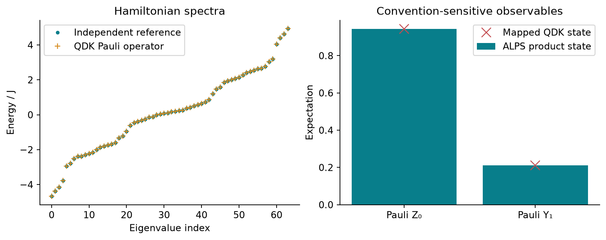

<!--
Copyright (c) 2026 Tobias Wolf
SPDX-License-Identifier: MIT

Adapted from skilledwolf/alpsx (private repository), branch
agent/v3-execution-and-api-audit at d37e51227,
python/qdk-chemistry-alps/docs/examples/custom-spin.md. Changes: pyalps names;
plain commands; figure and data re-measured; the presentation notes are not
carried over.
-->

# A custom spin model goes into QDK

Export a model that does not need a matching named QDK factory. This six-spin cluster–Ising chain includes a three-site interaction, nonuniform fields, a local Y field and a constant offset.

## Run

After [setup](../install.md), run from the **ALPS repository root**:

```bash
python python/qdk-chemistry-alps/examples/custom_spin_export.py --output /tmp/alps-demos
```

The source is [`examples/custom_spin_export.py`](../../examples/custom_spin_export.py); `--output` is optional, needs `matplotlib`, and is best a directory outside the repository.

## Physical model

With open boundaries and $L=6$ spin-$1/2$ sites, the Hamiltonian is

$$
\begin{aligned}
H &= -J\sum_{i=1}^{L-2}K_i-g\sum_{i=0}^{L-1}X_i
+\sum_{i=0}^{L-1}\varepsilon_i Z_i+b_yY_1+E_{\mathrm{off}}I,\\
K_i &= Z_{i-1}X_iZ_{i+1}.
\end{aligned}
$$

Here $X,Y,Z$ are **Pauli matrices**, $I$ is the identity, $J=1$, $g=0.37$, $\varepsilon_i=-0.19+0.092i$, $b_y=0.11$ and $E_{\mathrm{off}}=0.13$. All coefficients are energies in units of $J$. Since $X=2S^x$, the ALPS expression for $-J K_i$ contains $-8J S_{i-1}^zS_i^xS_{i+1}^z$:

```python
from pyalps import models

spin = models.Spin()
h = models.Hamiltonian(models.lattice.chain(6, bc="open"), spin)
h.add(-8 * spin.Sz(i - 1) * spin.Sx(i) * spin.Sz(i + 1))   # for i = 1 .. 4
```

Keeping this normalization explicit prevents a factor-of-eight change in the three-spin coupling.

The three-site operators satisfy $K_i^2=I$ and commute with one another. For the cluster term alone, positive $J$ favors their $+1$ eigenvalues. These operators characterize multi-spin correlations and appear as stabilizers in [cluster-state quantum computation](https://arxiv.org/abs/quant-ph/0010033). The interior stabilizers on an open chain leave edge degrees of freedom; they do not by themselves select a unique state. The transverse $X$ field competes with the cluster interaction, while the additional nonuniform fields make this a more general interacting model.

The local $Y$ term is useful physically and as an interoperability check:

$$
Y=\begin{pmatrix}0&-\mathrm{i}\\ \mathrm{i}&0\end{pmatrix}.
$$

It is Hermitian but has imaginary matrix elements, so an export that silently discards complex phases will fail. The scalar offset shifts every energy equally without changing any eigenstate.

## Reading the comparison

The left panel compares the full energy spectrum before and after export. The right panel uses an intentionally asymmetric **test state**, not the ground state:

$$
\begin{aligned}
\lvert\psi\rangle &= \bigotimes_{i=0}^{5}
\left(\cos\theta_i\lvert0\rangle
+e^{\mathrm{i}\phi_i}\sin\theta_i\lvert1\rangle\right),\\
\theta_i&=0.17+0.09i,\qquad \phi_i=0.23+0.21i.
\end{aligned}
$$

For this state, $\langle Z_i\rangle=\cos(2\theta_i)$ and $\langle Y_i\rangle=\sin(2\theta_i)\sin\phi_i$. Comparing $Z_0$ and $Y_1$ therefore tests both the physical site assignment and the relative phase. A permutation of basis states preserves every eigenvalue, so spectrum agreement alone cannot establish that a site-resolved observable was mapped correctly. If $U$ is the basis permutation, consistency requires $H_{\mathrm{QDK}}=UH_{\mathrm{ALPS}}U^{\dagger}$, $\lvert\psi_{\mathrm{QDK}}\rangle=U\lvert\psi\rangle$ and $O_{\mathrm{QDK}}=UOU^{\dagger}$.

The exported operator has six qubits, 18 Pauli terms and maximum support three, meaning no term acts nontrivially on more than three qubits. These are representation statistics, not estimates of hardware runtime.



[Saved numerical data and provenance](../figures/demos/custom_spin_export.json). This is **static operator export**; the example does not evolve the three-site interaction. The [quench example](spin-quench.md) evolves a model with two-site interactions.

## Why the phase and ordering checks matter

Independently constructed Kronecker matrices check the complete operator to `1e-12`, including the complex Y matrix and the constant. An asymmetric complex product state tests operator action and the mapped Z and Y expectations. Deliberately omitting the bit reversal must give a discrepancy larger than `0.1`; matching spectra alone would miss that error.

pyalps puts site 0 at the most significant local digit; a QDK Chemistry Pauli matrix puts qubit 0 at the least significant bit. See [Conventions](../conventions.md). The script compares matrices only after applying that transformation.
