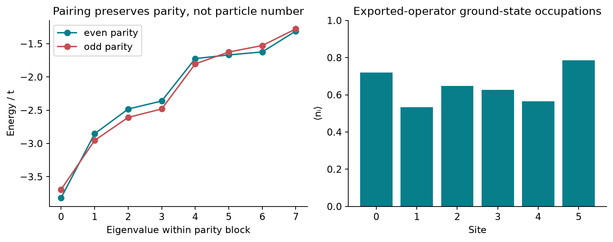

<!--
Copyright (c) 2026 Tobias Wolf
SPDX-License-Identifier: MIT

Adapted from skilledwolf/alpsx (private repository), branch
agent/v3-execution-and-api-audit at d37e51227,
python/qdk-chemistry-alps/docs/examples/fermion-pairing.md. Changes: pyalps
names (models.to_pauli_operator, compile_observable for observables); plain
commands; figure, data and numbers re-measured; the SDK-consumer note is not
carried over.
-->

# Spinless pairing without chemistry integrals

An ALPS model outside the restricted electronic-integral bridge can still become a QDK Pauli operator. This six-site interacting Kitaev-type chain has hopping, complex pairing, a nonuniform chemical potential and a nearest-neighbour density interaction.

## Run

After [setup](../install.md), run from the **ALPS repository root**:

```bash
python python/qdk-chemistry-alps/examples/fermion_pairing.py --output /tmp/alps-demos
```

The source is [`examples/fermion_pairing.py`](../../examples/fermion_pairing.py); `--output` is optional, needs `matplotlib`, and is best a directory outside the repository.

## Physical model

Each site hosts one spinless fermionic mode, either empty or occupied. The creation and annihilation operators obey $\{c_i,c_j^{\dagger}\}=\delta_{ij}$ and $\{c_i,c_j\}=0$, with occupation $n_i=c_i^{\dagger}c_i$. On an open chain of $L=6$ sites,

$$
\begin{aligned}
H &=-t\sum_{i=0}^{L-2}
\left(c_i^{\dagger}c_{i+1}+c_{i+1}^{\dagger}c_i\right)\\
&\quad+\sum_{i=0}^{L-2}
\left(\Delta c_ic_{i+1}+\Delta^*c_{i+1}^{\dagger}c_i^{\dagger}\right)\\
&\quad-\sum_{i=0}^{L-1}\mu_i\left(n_i-\tfrac12\right)
+V\sum_{i=0}^{L-2}n_in_{i+1}.
\end{aligned}
$$

In hopping units, $t=1$, $\Delta=0.3+0.12\mathrm{i}$, $\mu_i=0.7+0.05i$ and $V=0.15$; here $i$ in $\mu_i$ is the site index, while $\mathrm{i}$ is the imaginary unit. Hopping moves fermions between neighbors, $\Delta$ creates or annihilates a neighboring pair, the chemical potential controls occupation, and positive $V$ penalizes simultaneous occupation of adjacent sites. Notice the reversed creation-operator order in the pairing term: $(c_ic_{i+1})^{\dagger}=c_{i+1}^{\dagger}c_i^{\dagger}$. Reordering fermion operators would introduce a minus sign.

The noninteracting version is the starting point of [Kitaev's quantum-wire model](https://arxiv.org/abs/cond-mat/0010440). Here the finite interacting chain is an interoperability example; its plotted spectrum alone does not establish a topological phase or protected edge modes.

## Number changes, parity survives

Let $N=\sum_i n_i$ count particles. Pair annihilation changes it by two:

$$
[N,c_ic_{i+1}]=-2c_ic_{i+1},
\qquad [H,N]\ne0,
\qquad [H,\mathcal P]=0,
\qquad \mathcal P=e^{\mathrm{i}\pi N}=(-1)^N.
$$

Thus the Hamiltonian separates into even- and odd-parity blocks, even though each block mixes several particle numbers. The left panel compares the lowest eight energies in each parity block. The ground state has $E_0/t=-3.8192621871$ and $\operatorname{Var}(N)=\langle N^2\rangle-\langle N\rangle^2\simeq0.33337$: it is not a state of definite particle number. The right panel shows the occupations $\langle n_i\rangle$ in that ground state.

The anomalous expectation $F_{01}=\langle c_0c_1\rangle=-0.0854+0.0341\mathrm{i}$ tests coherence between components whose particle numbers differ by two. It must vanish in a fixed-number state but can be nonzero here because pairing is explicitly present in $H$. Its complex phase depends on the fermionic phase convention and the chosen pairing amplitude; a nonzero value in this finite model is not, by itself, evidence for spontaneous symmetry breaking.

## How fermions become qubits

For spinless modes, the Jordan–Wigner map is

$$
c_j=\left(\prod_{k<j}Z_k\right)\frac{X_j+\mathrm{i}Y_j}{2},
\qquad n_j=\frac{I-Z_j}{2},
\qquad \mathcal P=\prod_{j=0}^{L-1}Z_j.
$$

The computational state $\lvert0\rangle$ is empty and $\lvert1\rangle$ occupied. The preceding $Z$ string supplies the sign from moving a fermion past occupied earlier modes, ensuring anticommutation between different sites. The C++ compiler of `ALPS::models` handles these signs and the local Pauli decomposition; Python converts the result into a QDK container:

```python
from pyalps import models
from qdk_chemistry_alps.interop import pauli_operator_to_qubit_operator

encoded = models.to_pauli_operator(h)
qubit_operator = pauli_operator_to_qubit_operator(encoded)
register_index = encoded.state_index([1, 0, 1, 0, 0, 0])

site = h.site_for(0)
occupation = models.to_pauli_operator(
    models.compile_observable(h, site.n(2)), models.physical_basis(h),
    require_hermitian=False, require_conservation=False,
)
```



[Saved numerical data and provenance](../figures/demos/fermion_pairing.json). The model yields six qubits and 32 Pauli terms. The example checks both parity conservation and particle-number nonconservation, including a nonzero $F_{01}$. Ground-state occupations in the figure come from NumPy diagonalization of the exported operator; this example demonstrates interoperability, while the [quench](spin-quench.md) demonstrates QDK circuit execution.

## Model and independent checks

A separate reference in the script applies fermion creation and annihilation directly to occupation integers and checks every matrix element, the ALPS-to-register state map and observable action to `1e-12`. The native compiler's own tests cover long-range complex hopping, spinful spin mixing, higher-body interactions, canonical anticommutation, constants, zero operators, Hermiticity and stale conserved charges.

## Encoding and limits

Declare no conserved quantum numbers for this pairing model: the export refuses a declared `N` that the Hamiltonian does not conserve. The compiler produces a full-space Jordan–Wigner operator in ALPS local-basis order, not a projected particle sector. Site 0 occupies the least significant bits. Spinless occupation is one bit per site; supported spinful sites use two bits and keep their local fermionic phases.

Keep `encoded` alongside the QDK object: it supplies the layout and state-index map. QDK's blocked/interleaved chemistry metadata does not describe this convention, so those fields are left unset. The `ci_vector_to_qubit_statevector` helper belongs to the blocked chemistry path and must not be used here.

This direct route allocates neither a global dense Hamiltonian nor four-index integrals during export. The example's separate verification intentionally uses small dense matrices. Export has an explicit term limit and reports the pruned coefficient weight. Fermionic export uses binary Jordan–Wigner encoding; constrained sites, mixtures of higher-dimensional bosonic and fermionic sites, and automatic tapering remain outside its supported scope. Finite bosonic spaces separately support binary and Gray encodings, as demonstrated by the [spin-1 example](spin-one-anisotropy.md); see [Conventions](../conventions.md#higher-spins-and-finite-local-spaces). This example makes no claim about quantum advantage.
