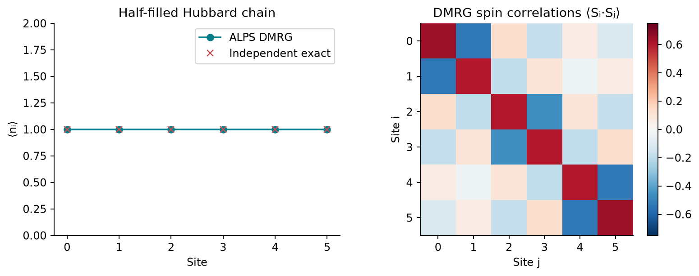

<!--
Copyright (c) 2026 Tobias Wolf
SPDX-License-Identifier: MIT

Adapted from skilledwolf/alpsx (private repository), branch
agent/v3-execution-and-api-audit at d37e51227,
python/qdk-chemistry-alps/docs/examples/hubbard-reference.md. Changes:
alps_classic_dmrg replaces alps_dmrg, with its fixed-state schedule; plain
commands; figure, data and numbers re-measured; the presentation notes are
not carried over.
-->

# Hubbard: energies and correlations

A QDK user constructs a Hubbard Hamiltonian, selects `alps_ed` or `alps_classic_dmrg` through the registry, and obtains both a ground-state energy and physical correlations.

## Run

After [setup](../install.md), run from the **ALPS repository root**:

```bash
python python/qdk-chemistry-alps/examples/hubbard_reference.py --output /tmp/alps-demos
```

The source is [`examples/hubbard_reference.py`](../../examples/hubbard_reference.py); `--output` is optional, needs `matplotlib`, and is best a directory outside the repository.

## Physical model

The Hubbard model captures the competition between electron motion and repulsion when two electrons occupy the same site. For an open chain of $L$ sites,

$$
H = -t\sum_{i=0}^{L-2}\sum_{\sigma=\uparrow,\downarrow}
\left(c_{i\sigma}^{\dagger}c_{i+1,\sigma}
+c_{i+1,\sigma}^{\dagger}c_{i\sigma}\right)
+U\sum_{i=0}^{L-1}n_{i\uparrow}n_{i\downarrow},
\qquad n_{i\sigma}=c_{i\sigma}^{\dagger}c_{i\sigma}.
$$

The fermionic operator $c_{i\sigma}^{\dagger}$ creates an electron of spin $\sigma$ at site $i$. The hopping $t$ favors delocalization; a positive $U$ penalizes double occupancy. Each site can be empty, spin up, spin down or doubly occupied. This example uses $L=6$, $N_\uparrow=N_\downarrow=3$, $t=1$ and $U=4$: **half filling** means six electrons on six sites. The fixed-particle-number Hilbert space has $\binom{6}{3}^2=400$ states, small enough for ED to serve as an independent reference for DMRG. See the [shared solver background](index.md#shared-notation-and-solver-background) for the distinction between these methods.

Repulsion suppresses double occupancy but does not eliminate it at finite $U/t$. In the large-$U/t$ limit, virtual hops through a doubly occupied intermediate state generate antiferromagnetic exchange $J_{\mathrm{ex}}=4t^2/U$. This explains the tendency toward neighboring spins pointing oppositely; at $U/t=4$, the calculation still uses the full Hubbard Hamiltonian, not that limiting spin model.

## Reading the observables

Both solvers give $E_0/t=-3.0925653195$. The density panel shows $\langle n_i\rangle=1$, where $n_i=n_{i\uparrow}+n_{i\downarrow}$. This is an expectation value: empty and doubly occupied configurations still contribute to the wavefunction.

The correlation heatmap measures

$$
\begin{aligned}
C_{ij} &= \langle\mathbf S_i\cdot\mathbf S_j\rangle
= \langle S_i^zS_j^z\rangle
+\tfrac12\langle S_i^+S_j^-+S_i^-S_j^+\rangle,\\
S_i^z &= \tfrac12(n_{i\uparrow}-n_{i\downarrow}),
\qquad S_i^+=c_{i\uparrow}^{\dagger}c_{i\downarrow},
\qquad S_i^-=(S_i^+)^{\dagger}.
\end{aligned}
$$

Negative nearest-neighbor entries indicate antiferromagnetic correlations, $\langle\mathbf S_i\cdot\mathbf S_{i+1}\rangle = -0.537, -0.183, -0.462, -0.183, -0.537$ along the chain. They reveal structure absent from the uniform density, without implying a static Néel state or thermodynamic long-range order in this six-site system. The diagonal measures the local moment, $C_{ii}=\tfrac34\bigl(\langle n_i\rangle-2\langle n_{i\uparrow}n_{i\downarrow}\rangle\bigr)$: empty and doubly occupied sites carry no spin, so charge fluctuations reduce the moment below the singly occupied value $3/4$.



[Saved numerical data and provenance](../figures/demos/hubbard_reference.json). Energies are in hopping units, not hartree.

## What is checked

A separate occupation-bit implementation in the script assembles the fixed-particle-number Hamiltonian and spin operators, independently of both ALPS solvers. All spin correlations and occupations are checked against its exact ground state. ED and DMRG energies must agree with this reference to `1e-8`; measured density and occupations must match the RDM identities to `1e-9`. The recorded maximum spin-correlation discrepancy is about `1e-15`.

The DMRG run keeps up to 128 states over 12 sweeps, with the default warm-up and fixed-state sweeps; at six sites the sweeps keep every block whole. Agreement on this small model does not establish convergence for a different model or larger system. The [convergence guide](../how-to/converging-dmrg.md) covers that separate question.
