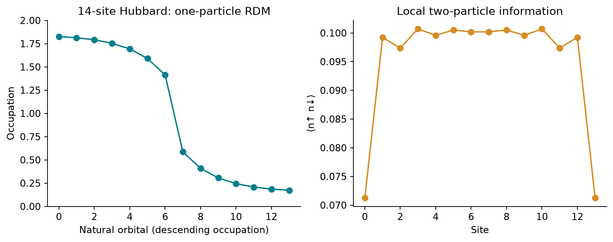

<!--
Copyright (c) 2026 Tobias Wolf
SPDX-License-Identifier: MIT

Adapted from skilledwolf/alpsx (private repository), branch
agent/v3-execution-and-api-audit at d37e51227,
python/qdk-chemistry-alps/docs/examples/rdm-observables.md. Changes: the RDMs
come from pyalps.classic_dmrg.solve_molecular instead of an alpsx MPS; plain
commands; figure, data and numbers re-measured; the local-moment check is
new; the collapsible sections are plain text.
-->

# Fourteen-site results without a CI vector

Measure the reduced quantities that answer a physical question, without reconstructing every determinant amplitude. This is an **ALPS-native workflow**: it runs with released qdk-chemistry 2.2.1 and does not return a QDK wavefunction container.

## Run

After [setup](../install.md), run from the **ALPS repository root**:

```bash
python python/qdk-chemistry-alps/examples/rdm_observables.py --output /tmp/alps-demos
```

The source is [`examples/rdm_observables.py`](../../examples/rdm_observables.py); `--output` is optional, needs `matplotlib`, and is best a directory outside the repository.

## The physical question

Consider the same [repulsive Hubbard Hamiltonian](hubbard-reference.md#physical-model) as the small reference example, now on an open chain of $L=14$ sites with $t=1$, $U=4$ and $N_\uparrow=N_\downarrow=7$. Its fixed-number Hilbert space contains $\binom{14}{7}^2=11{,}778{,}624$ determinants. Instead of expanding the DMRG state into every determinant amplitude, ask which reduced quantities are sufficient to measure charge delocalization, double occupancy and energy.

The script builds the model with `pyalps.models`, extracts its integrals with `hamiltonian_to_integrals`, and runs `pyalps.classic_dmrg.solve_molecular`, which reads the reduced density matrices from the final state:

```python
from pyalps import classic_dmrg as dmrg
from pyalps import models
from qdk_chemistry_alps.interop import hamiltonian_to_integrals

h = models.hubbard(models.lattice.chain(14, bc="open"), t=1.0, U=4.0)
h1, eri, core = hamiltonian_to_integrals(h)
result = dmrg.solve_molecular(h1, eri, 7, 7, core_energy=core, sweeps=dmrg.fixed_sweeps(8, 64))
gamma = result.one_rdm
doubles = dmrg.local_expectations(result, "n_updn")
```

The spin-summed one-particle reduced density matrix (1-RDM) is

$$
\gamma_{ij}=\sum_{\sigma=\uparrow,\downarrow}
\langle c_{j\sigma}^{\dagger}c_{i\sigma}\rangle,
\qquad \gamma_{ji}=\gamma_{ij}^*,
\qquad \operatorname{Tr}\gamma=N=14,
$$

the convention of PySCF and of `result.one_rdm`. The diagonal is the local occupation $\gamma_{ii}=\langle n_i\rangle$; off-diagonal elements describe one-electron coherence between sites and determine the hopping energy. Unlike a normalized many-body density operator, this 1-RDM has trace equal to the particle number, not one. All entries are expectation values in the computed DMRG state.

## Natural occupations and local moments

Diagonalizing the 1-RDM gives **natural orbitals** $u_\alpha$ and their occupations $n_\alpha$:

$$
\gamma u_\alpha=n_\alpha u_\alpha,
\qquad 0\le n_\alpha\le2,
\qquad \sum_{\alpha=1}^{L}n_\alpha=14.
$$

The upper bound is two because the RDM is spin summed. The left panel plots these eigenvalues, not the occupations of individual sites; they run from 1.83 down to 0.17. A closed-shell Slater determinant has occupations zero or two in its natural-orbital basis. Fractional values in this pure, half-filled ground-state calculation show departure from that closed-shell description. They coexist with a uniform site density $\langle n_i\rangle=1$; changing the orbital basis mixes sites but leaves the eigenvalues unchanged.

The right panel shows the double occupancy $d_i=\langle n_{i\uparrow}n_{i\downarrow}\rangle$, the probability that both spins occupy site $i$: about 0.10 in the bulk and 0.071 at the ends. Repulsion suppresses it relative to the noninteracting half-filled value $1/4$. A useful connection to spin physics is

$$
\langle\mathbf S_i^2\rangle=\tfrac34\left(\gamma_{ii}-2d_i\right).
$$

Empty and doubly occupied sites have zero spin; only singly occupied sites contribute to the local moment, here about 0.60 in the bulk against $3/4$ for a singly occupied site. Reducing charge fluctuations can therefore strengthen local moments even when the average density stays fixed. The script checks this identity: the left side comes from the spin blocks of the 2-RDM, the right side from the density and the double occupancy.

## Reconstructing the energy

The Hubbard Hamiltonian only needs nearest-neighbor elements of the 1-RDM and the local double occupancies:

$$
\begin{aligned}
E_{\mathrm{kin}} &=-t\sum_{i=0}^{L-2}
\left(\gamma_{i,i+1}+\gamma_{i+1,i}\right),\\
E_{\mathrm{int}} &=U\sum_{i=0}^{L-1}d_i,\\
\langle H\rangle &=E_{\mathrm{kin}}+E_{\mathrm{int}}.
\end{aligned}
$$

The kinetic contribution moves one electron and is therefore fixed by the 1-RDM. The interaction is a two-particle observable, but here only its on-site double-occupancy elements are needed. Contracting these quantities reconstructs the reported DMRG energy, $E/t=-7.6723438313$, to $2.7\times10^{-15}$. This is a consistency check on measurements of the same state, not proof that the state is the exact ground state. The kept states and sweep convergence require [separate checks](../how-to/converging-dmrg.md).



[Saved numerical data and provenance](../figures/demos/rdm_observables.json). Energy reconstruction checks that the measurements describe the computed state; it does not prove that eight sweeps of 64 kept states have converged to the exact ground state.

## Returned QDK containers and memory

[`large_active_space.py`](../how-to/large-active-spaces.md) runs the same chain through the `alps_classic_dmrg` calculator and returns these RDMs as a QDK `RdmContainer`. That needs a qdk-chemistry build that provides the class; released 2.2.1 does not. Do not describe this ALPS-native route as a returned QDK wavefunction.

At this determinant count, a raw real coefficient vector occupies about 94 MB (188 MB for complex128); as qdk-chemistry determinant objects it would take about 12 GB, the calculator's estimate at 1 kB per determinant. The engine computes the full two-particle RDM, $L^4$ elements in the spin-summed array and in each of its three spin blocks, about 1.2 MB at fourteen sites. That storage scales as the fourth power of the orbital count, while this Hubbard question needs only its local double-occupancy elements.
