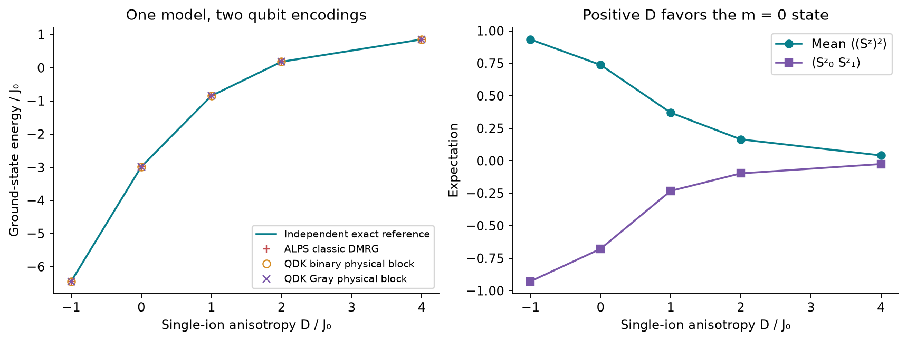

<!--
Copyright (c) 2026 Tobias Wolf
SPDX-License-Identifier: MIT

Adapted from skilledwolf/alpsx (private repository), branch
agent/v3-execution-and-api-audit at d37e51227,
python/qdk-chemistry-alps/docs/examples/spin-one-anisotropy.md. Changes: the
ground states and expectations come from pyalps.classic_dmrg.solve; pyalps
names; plain commands; figure, data and numbers re-measured; the collapsible
sections are plain text; the presentation notes and the design-page link
are not carried over.
-->

# Spin-1 anisotropy: a physical model beyond qubits

Increasing single-ion anisotropy changes which local spin states are occupied. ALPS classic DMRG and two QDK encodings describe the same spin-1 model, including biquadratic exchange and observables.

## Run

After [setup](../install.md), run from the **ALPS repository root**:

```bash
python python/qdk-chemistry-alps/examples/spin_one_anisotropy.py --output /tmp/alps-demos
```

The source is [`examples/spin_one_anisotropy.py`](../../examples/spin_one_anisotropy.py), with the model and its independent matrix reference in [`examples/demo_support/spin_one.py`](../../examples/demo_support/spin_one.py); `--output` is optional, needs `matplotlib`, and is best a directory outside the repository.

## Physical model

A spin-$1$ site has three states $\lvert m\rangle$ with $m=+1,0,-1$, where $S^z\lvert m\rangle=m\lvert m\rangle$ and $\hbar=1$. The open four-site chain has Hamiltonian

$$
\begin{aligned}
H(D) &= \sum_{i=0}^{2}\left[
J_i\,\mathbf S_i\cdot\mathbf S_{i+1}
+K\left(\mathbf S_i\cdot\mathbf S_{i+1}\right)^2\right]\\
&\quad +D\sum_{i=0}^{3}(S_i^z)^2
+\sum_{i=0}^{3}h_iS_i^z+E_{\mathrm{off}}I.
\end{aligned}
$$

Here $\mathbf S_i\cdot\mathbf S_j=S_i^xS_j^x+S_i^yS_j^y+S_i^zS_j^z$ is Heisenberg exchange, $K$ controls biquadratic exchange, $D$ is the single-ion anisotropy and $h_i$ are longitudinal field coefficients. The couplings are $J_i/J_0=(1,0.8,1.2)$, $K/J_0=0.18$, $h_i/J_0=(0.07,-0.11,0.16,-0.03)$ and $E_{\mathrm{off}}/J_0=0.37$. The energy unit is $J_0=1$, and the sweep uses $D/J_0=-1,0,1,2,4$.

The key difference from spin $1/2$ is visible in the local matrices:

$$
S^z=\begin{pmatrix}1&0&0\\0&0&0\\0&0&-1\end{pmatrix},
\qquad
(S^z)^2=\begin{pmatrix}1&0&0\\0&0&0\\0&0&1\end{pmatrix}.
$$

Positive $D$ raises the energies of $m=\pm1$ relative to $m=0$; negative $D$ favors the $m=\pm1$ levels. For spin $1/2$, by contrast, $(S^z)^2=I/4$, so the same term would only shift the energy. Spin $1$ therefore provides a genuine additional local degree of freedom. At sufficiently large positive $D$, the ground state approaches $\lvert0,0,0,0\rangle$, with exchange-induced admixtures at finite $D$.

## From local populations to the figure

For the ground state at each $D$, let $\rho_i$ be the reduced density matrix of site $i$, obtained by tracing out the other sites. Its diagonal elements $p_i(m)=\langle m\rvert\rho_i\lvert m\rangle$ are the local spin probabilities. Consequently,

$$
q_i=\langle(S_i^z)^2\rangle=p_i(+1)+p_i(-1)=1-p_i(0),
\qquad \overline q=\frac14\sum_{i=0}^{3}q_i.
$$

Thus $q_i$ measures occupation of the two magnetic levels, even when $\langle S_i^z\rangle=p_i(+1)-p_i(-1)$ vanishes. The other observable, $C_{01}^{zz}=\langle S_0^zS_1^z\rangle$, tests longitudinal correlations across the first bond. This is the raw correlation; a connected correlation would additionally subtract $\langle S_0^z\rangle\langle S_1^z\rangle$.



As $D/J_0$ increases from $-1$ to $4$, the mean population $\overline q$ falls from **0.934 to 0.041**. The negative first-bond correlation weakens from $-0.928$ to $-0.025$ as the sites increasingly occupy $m=0$. The energy markers agree across the independent exact reference, ALPS DMRG and both QDK physical blocks. This four-site crossover illustrates local spin physics; it does not establish a thermodynamic phase transition.

Each encoding uses two qubits per spin, so an eight-qubit register contains a physical subspace of dimension $3^4=81$ within $2^8=256$ register states. An isometry $V$ maps each physical spin basis state to its binary or Gray code, with $V^{\dagger}V=I$. The required equivalence is $H_qV=VH$, together with the same map for states and observables. The extra register states are not additional spin levels. The [spin-1 quench](spin-one-quench.md) explains how an approximate circuit can populate them.

[Saved data and provenance](../figures/demos/spin_one_anisotropy.json). The QDK operator is diagonalized as a matrix here; continue with the [spin-1 quench](spin-one-quench.md) for executed Q# circuits.

## Why biquadratic exchange adds independent physics

For two spin-$1$ sites, the total bond spin $F$ can be $0$, $1$ or $2$. From $(\mathbf S_i+\mathbf S_j)^2=\mathbf S_i^2+\mathbf S_j^2+2\mathbf S_i\cdot\mathbf S_j$ and $S(S+1)=2$,

$$
\mathbf S_i\cdot\mathbf S_j
=\tfrac12\left[F(F+1)-4\right]
=\begin{cases}-2,&F=0,\\-1,&F=1,\\+1,&F=2.\end{cases}
$$

Squaring gives eigenvalues $4,1,1$. The bond energies are therefore $-2J_i+4K$, $-J_i+K$ and $J_i+K$ in the three channels. Varying $K$ changes their relative energies in a way that cannot be reproduced by rescaling $J_i$ and adding a constant. The anisotropy and fields need not conserve bond spin; the channel decomposition explains the exchange term itself.

## What is checked

The reference builds angular-momentum matrices directly, without reading ALPS site matrices. It checks the full physical Hamiltonian and, separately, reads QDK's Pauli container to verify $H_qV=VH$, every physical eigenvalue, mapped state amplitudes and the $(S^z)^2$ observable. The maximum mapped-operator discrepancy is `8.0e-15`.

DMRG uses the conserved total magnetization $M_z=\sum_i S_i^z=0$, six sweeps of 32 kept states. The reference checks that the full physical ground state belongs to that sector before comparing energies to `1e-9`. The DMRG engine measures mean $(S^z)^2$ and the $S_0^zS_1^z$ correlation in its final state, and both are compared with independent exact expectations to `1e-8`. QDK export remains a full-space operator and does not inherit the DMRG sector restriction.

Nonuniform terms expose ordering mistakes. Same-site operator multiplication occurs before encoding, which matters for both $(S^z)^2$ and biquadratic exchange.

## Encoding and unused qubit states

Reuse `models.make_qubit_encoding(h, scheme=...)` for the Hamiltonian, observables and state. Binary uses local codes `00,01,10`; Gray uses `00,01,11`. The remaining code is unphysical. [Conventions](../conventions.md#higher-spins-and-finite-local-spaces) explains register order and the identity-preserving trace completion. An observable goes through the same encoding:

```python
encoding = models.make_qubit_encoding(h, scheme="gray")
hamiltonian = models.to_pauli_operator(h, encoding=encoding, tolerance=0.0)
observable = models.to_pauli_operator(models.compile_observable(h, expression), models.physical_basis(h),
                                      encoding=encoding, tolerance=0.0)
```

The code verifies the physical block explicitly. Trace completion also preserves the exact ground energy of the whole register, but unphysical states can be degenerate with physical ground states. That property is an additional check, not permission to infer physical membership from energy. No penalty or postselection is used.
