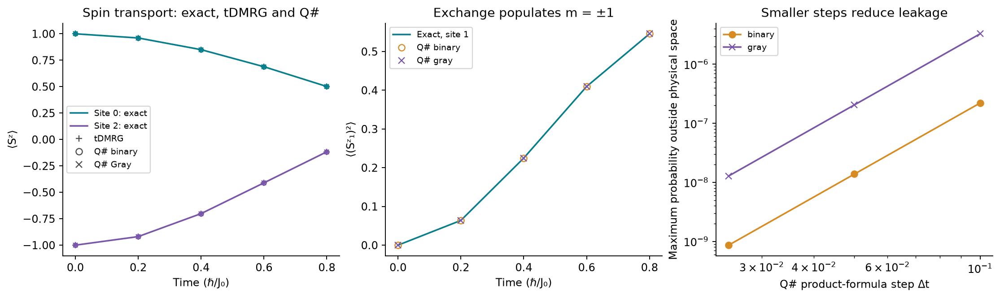

<!--
Copyright (c) 2026 Tobias Wolf
SPDX-License-Identifier: MIT

Adapted from skilledwolf/alpsx (private repository), branch
agent/v3-execution-and-api-audit at d37e51227,
python/qdk-chemistry-alps/docs/examples/spin-one-quench.md. Changes: the
classical trajectories are adaptive time-dependent DMRG from
pyalps.classic_dmrg.evolve instead of alpsx's MPS evolution, with a state
fidelity in place of the bond-cap comparison, which four sites cannot show; plain commands; figure, data
and numbers re-measured; the collapsible sections are plain text; the
presentation notes and the design-page links are not carried over.
-->

# Spin-1 dynamics: physical transport and encoding leakage

A nonuniform spin-1 product state evolves through ALPS time-dependent DMRG and actual Q# circuits. Spin moves between sites, `m=±1` populations grow on an initially `m=0` site, and circuit approximations can briefly leave the physical spin space.

## Run

After [setup](../install.md), run from the **ALPS repository root**; the Q# simulator comes with the `qdk` package, which qdk-chemistry installs:

```bash
python python/qdk-chemistry-alps/examples/spin_one_quench.py --output /tmp/alps-demos
```

The source is [`examples/spin_one_quench.py`](../../examples/spin_one_quench.py), with the model and its independent matrix reference in [`examples/demo_support/spin_one.py`](../../examples/demo_support/spin_one.py); `--output` is optional, needs `matplotlib`, and is best a directory outside the repository. The run takes about 30 seconds with the default 64 shots per encoding, almost all of it in the Q# simulator.

## Physical quench

Prepare the four-site spin-$1$ product state $\lvert\psi(0)\rangle=\lvert+1,0,-1,0\rangle$ and evolve it as $\lvert\psi(\tau)\rangle=e^{-\mathrm{i}H\tau}\lvert\psi(0)\rangle$, with $\hbar=1$. The open-chain Hamiltonian is

$$
\begin{aligned}
H &= \sum_{i=0}^{2}J_i\,\mathbf S_i\cdot\mathbf S_{i+1}
+D\sum_{i=0}^{3}(S_i^z)^2+\sum_{i=0}^{3}h_iS_i^z\\
&\quad +b_x S_1^x+b_y S_2^y+E_{\mathrm{off}}I.
\end{aligned}
$$

In units of $J_0=1$, the parameters are $J_i=(1,0.8,1.2)$, $D=0.65$, $h_i=(0.07,-0.11,0.16,-0.03)$, $b_x=0.17$, $b_y=0.09$ and $E_{\mathrm{off}}=0.37$. Unlike the [static anisotropy example](spin-one-anisotropy.md), this dynamics example has no biquadratic interaction. It compares independent exact propagation, ALPS tDMRG and binary/Gray Q# circuits up to $\tau=0.8$ in units of $\hbar/J_0$.

The exchange term explains how magnetization moves between neighbors:

$$
\begin{aligned}
\mathbf S_i\cdot\mathbf S_j
&=S_i^zS_j^z+\tfrac12(S_i^+S_j^-+S_i^-S_j^+),\\
S^{\pm}\lvert m\rangle
&=\sqrt{2-m(m\pm1)}\,\lvert m\pm1\rangle.
\end{aligned}
$$

For spin $1$, the ladder operators connect $m=-1,0,+1$ and annihilate a state when raising or lowering would leave that range. The exchange can transfer $\lvert+1,0\rangle$ into $\lvert0,+1\rangle$, or mix $\lvert0,0\rangle$ with $\lvert+1,-1\rangle$. Exchange, longitudinal fields and anisotropy all conserve $M_z=\sum_i S_i^z$. The transverse fields do not, so the full dynamics combines transport with changes in total magnetization, and the tDMRG runs without a sector.

## Reading the trajectories

We monitor all four magnetizations $m_i(\tau)=\langle S_i^z\rangle$, all four magnetic-level populations $q_i(\tau)=\langle(S_i^z)^2\rangle$, and the first-bond correlation $C_{01}^{zz}(\tau)=\langle S_0^zS_1^z\rangle$. These are nine observables, with expectations taken in the evolving state. If $p_i(m)$ is the local spin probability, then

$$
m_i=p_i(+1)-p_i(-1),
\qquad q_i=p_i(+1)+p_i(-1)=1-p_i(0).
$$

Initially $m=(1,0,-1,0)$ and $q=(1,0,1,0)$. A site can develop a large $q_i$ while its magnetization remains small: comparable $+1$ and $-1$ populations cancel in $m_i$. This is why the population panel adds information beyond magnetization alone.



The plotted Q# points are **deterministic expectations from the executed circuit state**. A separate Q# measurement run checks finite-shot sampling. No samples are discarded, and no state is projected back into the physical space. The right panel shows that leakage decreases as the product-formula step shrinks.

[Saved trajectories, exact Q# source, measurement counts and provenance](../figures/demos/spin_one_quench.json).

## Why an encoded spin can leak

Two qubits represent each three-level spin. Binary assigns $m=(+1,0,-1)$ to codes $(00,01,10)$; Gray assigns them to $(00,01,11)$. One local code is unused in each case. Let $V$ embed the physical $3^4$-dimensional space in the eight-qubit register and $\Pi=VV^{\dagger}$ project onto it. The exported Hamiltonian obeys $H_qV=VH$ and $[H_q,\Pi]=0$, so **exact** evolution starting in the physical space stays there.

The circuit instead decomposes $H_q=\sum_{\ell=1}^{M}a_\ell P_\ell$ into Pauli strings $P_\ell$ with real coefficients $a_\ell$. A symmetric second-order step is

$$
U_2(\delta\tau)=
\left(\prod_{\ell=1}^{M}e^{-\mathrm{i}a_\ell P_\ell\delta\tau/2}\right)
\left(\prod_{\ell=M}^{1}e^{-\mathrm{i}a_\ell P_\ell\delta\tau/2}\right),
$$

where the second product reverses the order of the first. Repeating this step approximates $e^{-\mathrm{i}H_q\tau}$, with global error $O\!\left(\tau(\delta\tau)^2\right)$ at fixed Hamiltonian. Individual Pauli strings need not commute with $\Pi$, and the approximate full step can therefore leave a small amplitude on invalid register states. The measured leakage is

$$
\mathcal L(\tau)=1-
\frac{\langle\psi_q(\tau)\rvert\Pi\lvert\psi_q(\tau)\rangle}
{\langle\psi_q(\tau)\vert\psi_q(\tau)\rangle}.
$$

The denominator accounts for numerical norm drift when reporting a probability; the simulation state is not altered. A leading state error of order $(\delta\tau)^2$ can produce invalid-space probability of order $(\delta\tau)^4$. That explains the sixteenfold leakage reduction on step halving in this example, alongside fourfold observable-error reduction. It is a convergence observation for this circuit, not a guarantee for every encoding or synthesis method.

Encoding changes both the Pauli strings and their commutators, so fewer gates per step need not mean fewer gates at a required accuracy. For broader background, see [Sawaya et al. on digital simulation of finite-dimensional systems](https://www.nature.com/articles/s41534-020-0278-0).

## What the comparison teaches

Gray has a smaller gate estimate **per step** here, but binary reaches the chosen physical accuracy with fewer steps. This is why an encoding should be judged together with the simulation algorithm and the required accuracy.

| Encoding | Qubits | Coarsest tested step meeting all targets | Pauli rotations to $\tau=0.8$ | CNOT-ladder estimate to $\tau=0.8$ |
| --- | --- | --- | --- | --- |
| Binary | 8 | 0.05 | 4,096 | 17,536 |
| Gray | 8 | 0.025 | 8,192 | 27,136 |

The shared targets are maximum error below $5\times10^{-4}$ in all nine physical observables at all sampled times, leakage below $10^{-7}$, and state infidelity $1-F$ below $10^{-6}$. For normalized states, $F=\lvert\langle V\psi_{\mathrm{exact}}\vert\psi_q\rangle\rvert^2$ tests the full state, including relative phases. The gate counts describe the explicit unoptimized all-to-all CNOT-ladder construction, with no cancellation between rotations. They are **not compiled hardware counts or circuit depth**. This particular ordering favors binary at these targets; it establishes no universal encoding ranking.

## Model, ordering and observables

The reference assembles the 81-dimensional physical matrix independently using spin-1 angular-momentum matrices. The complex $S_2^y$ field makes state-phase checks informative.

Both layouts share their Hamiltonian, initial product-state map and observable exports. The script checks complete mapped operator action before circuit execution and probes Q# state-dump endianness with an asymmetric excitation. It checks all four $S^z$, all four $(S^z)^2$ and $S_0^zS_1^z$; the JSON names their order. Q# `Exp` uses a positive imaginary sign, so real-time evolution uses a negative angle. A scalar energy offset contributes only a global phase and is omitted from the circuit, as recorded in the controls.

## Independent approximation controls and results

Q# uses a symmetric second-order product formula over Pauli rotations, at steps `0.1`, `0.05` and `0.025`. Operator export uses zero coefficient pruning. Individual Pauli rotations need not preserve the physical subspace even though the complete encoded Hamiltonian does; leakage is measured as invalid-state probability divided by total norm. The states themselves are never renormalized or postselected. Step halving reduces observable error by about four and leakage by about sixteen for this case.

| Encoding | Step | Maximum observable error | Maximum leakage | Minimum fidelity |
| --- | --- | --- | --- | --- |
| Binary | 0.1 | `8.2e-4` | `2.2e-7` | `0.999997109` |
| Binary | 0.05 | `2.1e-4` | `1.4e-8` | `0.999999819` |
| Binary | 0.025 | `5.1e-5` | `8.6e-10` | `0.999999989` |
| Gray | 0.1 | `2.8e-3` | `3.3e-6` | `0.999984013` |
| Gray | 0.05 | `7.0e-4` | `2.1e-7` | `0.999999001` |
| Gray | 0.025 | `1.8e-4` | `1.3e-8` | `0.999999938` |

These are independent of shot uncertainty.

ALPS tDMRG applies second-order Trotter gates at steps `0.025` and `0.0125`. On four sites the classic DMRG never truncates the evolving state (a single kept state gives the same trajectories), so the Trotter step is its only approximation; the kept-states comparison of the [six-site quench](spin-quench.md#numerical-controls-and-acceptance-checks) has nothing to show here. Maximum observable error falls from `4.0e-5` to `9.9e-6`, and the states kept with `keep_mps=True` reach a minimum fidelity of $1-4\times10^{-10}$ against the exact states.

No noise model or device routing is used. Block-preserving synthesis, hardware resource estimates and symmetric or Dicke encodings remain separate work.

## Shots and validity diagnostics

`qdk.qsharp.run` executes 64 shots per encoding at the final time, with seeds 971 and 972. Increase `--shots` for more sampling evidence. All nine observables are diagonal, so the same computational-basis shots estimate them without basis-change gates. Preparation uses three X gates for binary and four for Gray; each shot measures eight qubits. These are recorded separately from evolution costs.

The script estimates the actual encoded observables unconditionally, including their specified values on invalid levels. It compares means against deterministic circuit expectations with a family-wise Hoeffding failure bound of `0.001` over the nine means for each encoding. Physical sample fraction is checked with a separate `0.001` bound. With only 64 shots, statistical intervals are broad and cannot resolve leakage near `1e-8`; the small leakage values come from the simulator state diagnostic, not from observing zero invalid shots. Raw register counts and bounds are saved.
