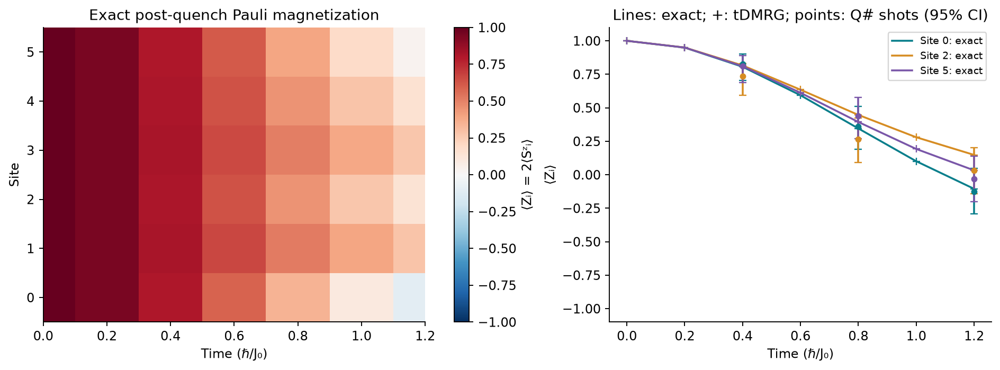

<!--
Copyright (c) 2026 Tobias Wolf
SPDX-License-Identifier: MIT

Adapted from skilledwolf/alpsx (private repository), branch
agent/v3-execution-and-api-audit at d37e51227,
python/qdk-chemistry-alps/docs/examples/spin-quench.md. Changes: the
classical trajectories are adaptive time-dependent DMRG from
pyalps.classic_dmrg.evolve instead of alpsx's MPS evolution; plain commands;
figure, data and numbers re-measured; the collapsible sections are plain
text; the presentation notes are not carried over.
-->

# Spin-chain quench: ALPS and Q# circuits

A single physical model drives three calculations: independent exact propagation, ALPS time-dependent DMRG and actual Q# circuits executed by QDK's simulator. The QDK points are finite-shot samples from that software simulator, not measurements on a physical device.

## Run

After [setup](../install.md), and with the `qdk` package's Q# simulator installed, run from the **ALPS repository root**:

```bash
python python/qdk-chemistry-alps/examples/spin_quench.py --output /tmp/alps-demos
```

The source is [`examples/spin_quench.py`](../../examples/spin_quench.py); `--output` is optional, needs `matplotlib`, and is best a directory outside the repository.

## Physical quench

A quench prepares a state and then lets it evolve under a Hamiltonian for which it is generally not an eigenstate. Here six spin-$1/2$ sites begin fully polarized in the Pauli-$Z$ basis:

$$
\lvert\psi(0)\rangle=\lvert0\rangle^{\otimes6},
\qquad Z\lvert0\rangle=\lvert0\rangle,
\qquad \lvert\psi(\tau)\rangle=e^{-\mathrm{i}H\tau}\lvert\psi(0)\rangle.
$$

We set $\hbar=1$, use $J_0$ as the energy unit and quote time $\tau$ in units of $\hbar/J_0$. The post-quench Hamiltonian on the open chain is

$$
\begin{aligned}
\frac{H}{J_0} &=-0.7\sum_{i=0}^{4}Z_iZ_{i+1}
-0.8\sum_{i=0}^{5}X_i+\sum_{i=0}^{5}h_iZ_i,\\
(h_0,\ldots,h_5)&=(0.07,-0.13,0.19,-0.09,0.16,-0.21).
\end{aligned}
$$

The negative $ZZ$ coupling favors aligned neighbors. The transverse $X$ field flips spins in the $Z$ basis and drives the initially polarized state away from equilibrium; the nonuniform longitudinal fields give different sites different local precession axes. As a simple reference, one isolated spin evolving under $-gX$ from $\lvert0\rangle$ has $\langle Z(\tau)\rangle=\cos(2g\tau)$. Interactions correlate the spins and modify this simple oscillation. The trajectories here describe coherent unitary dynamics, without a bath or noise model.

The ALPS side starts from the product configuration itself, local state 0 (spin up, $Z=+1$) on every site, so nothing is solved first:

```python
from pyalps import classic_dmrg as dmrg

run = dmrg.evolve([0] * 6, h, time_step=0.02, steps=60, states=8, measure_steps=10,
                  measurements={"Sz": "Sz"}, keep_mps=True)
z = 2 * run.measurements["Sz"].values      # Pauli Z of every site at the measured steps
```

The model conserves no charge, so there is no sector and the evolution covers the whole $2^6$-dimensional space.

## What the magnetization plot measures

The site-resolved observable is

$$
m_i(\tau)=\langle\psi(\tau)\rvert Z_i\lvert\psi(\tau)\rangle
=2\langle S_i^z(\tau)\rangle.
$$

Its range is $[-1,1]$, because the figure uses Pauli magnetization rather than the spin operator $S^z=Z/2$. Exact propagation and ALPS tDMRG give expectation values; Q# executes a product-formula approximation to the same propagator, then samples measurements at $\tau=0.4,0.8,1.2$. The default is 128 shots per time; increase it with `--shots 1024` for smaller error bars.

A $Z_i$ measurement returns $+1$ with probability $p_i=(1+m_i)/2$. If $n_+$ of $N_{\mathrm{shots}}$ shots give $+1$, the estimated magnetization and its sampling standard deviation are

$$
\widehat m_i=\frac{2n_+}{N_{\mathrm{shots}}}-1,
\qquad
\operatorname{sd}(\widehat m_i)=\sqrt{\frac{1-m_i^2}{N_{\mathrm{shots}}}}.
$$

The plot uses Wilson confidence intervals for the underlying binomial probability, transformed to magnetization; the standard-deviation formula explains the $1/\sqrt{N_{\mathrm{shots}}}$ scaling. A measured point need not fall exactly on the curve even when the circuit is accurate.

There are three independent approximation controls: the kept DMRG states limit representable entanglement, the tDMRG and circuit time steps control their respective propagation errors, and shot count controls sampling uncertainty. Both use symmetric second-order product formulas, whose global error is proportional to the square of the step at fixed final time, so step halving should reduce that error by approximately four once other errors are small. See the [shared solver background](index.md#shared-notation-and-solver-background) and the [explicit product formula in the spin-1 example](spin-one-quench.md#why-an-encoded-spin-can-leak) for more detail.



[Saved trajectories, circuit source, counts and provenance](../figures/demos/spin_quench.json). Lines are exact trajectories, plus signs are ALPS tDMRG, and circles are QDK circuit measurements with 95% Wilson intervals.

## Numerical controls and acceptance checks

The independent reference diagonalizes a separately assembled 64-dimensional Hamiltonian and applies `exp(-iHt)` to the initial state. ALPS is checked at time steps `0.04` and `0.02`, independently of QDK product-formula steps `0.1` and `0.05`. At the finer steps, the maximum Pauli-magnetization errors are `2.4e-5` for tDMRG and `5.6e-4` for QDK. Halving either step reduces its error by about four (from `9.6e-5` and `2.2e-3`), as expected for these second-order formulas.

The tDMRG keeps 8 states, the largest possible Schmidt rank across the middle of six qubits, so its only approximation is the Trotter step. A separate run keeps 2 states at the same step, and its error rises to `1.9e-4`: time-step convergence alone does not establish DMRG convergence. Norms, matching times, mapped observables and state fidelities are checked. The minimum QDK state fidelity is `0.99999739`; this phase-sensitive check also catches the wrong sign in the propagator. The tDMRG states, kept with `keep_mps=True`, reach a minimum fidelity of `0.999999998` against the exact states.

Finite-shot measurements are compared with deterministic circuit expectations using a family-wise Hoeffding bound with failure probability `0.001` across all 18 means. The plotted 95% intervals are per-point Wilson intervals, not simultaneous guarantees or a demand that every point contain the exact physical reference.

## Q# and layout conventions

[Q# Exp](https://learn.microsoft.com/en-us/qsharp/api/qsharp-lang/std.intrinsic/exp) implements `exp(+i θP)`, so time evolution uses a negative angle. The script reverses QDK Chemistry's Pauli strings when pairing them with the Q# array `q[0], q[1], ...`.

The QDK simulator's `StateDump` puts the first allocated qubit in the most significant position. The example asserts that convention using an asymmetric one-qubit excitation before comparing states. It separately uses `qdk.qsharp.run` for the shots; no NumPy sampler substitutes for QDK execution. The exact Q# source, random seeds, step sizes and counts are saved in the JSON.

Units are `ℏ=1`, with Hamiltonian coefficients in a common energy unit `J₀` and time in `ℏ/J₀`. This is a fixed post-quench Hamiltonian, a noiseless simulator comparison and a small product-state preparation. Continuously driven schedules, physical-device noise and general state preparation from a DMRG state remain separate work.
