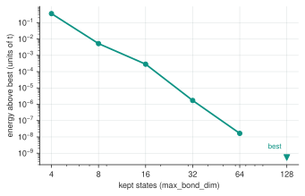

<!--
Copyright (c) 2026 Tobias Wolf
SPDX-License-Identifier: MIT

Adapted from skilledwolf/alpsx (private repository), branch
agent/v3-execution-and-api-audit at d37e51227,
python/qdk-chemistry-alps/docs/how-to/converging-dmrg.md. Changes: classic
block DMRG (kept states, fixed-state sweeps, warm-up, iteration energies)
instead of MPS DMRG (bond dimension, seed, MPO tolerance); the scan runs with
released qdk-chemistry; output and figure re-measured, figure in units of t.
-->

# Converge a DMRG run

`alps_classic_dmrg` keeps a truncated basis of block states. A successful run can still be under-converged: check the accuracy of the **energy and observables you intend to use**, varying the kept states, the sweep count and the tolerances.

For a normalized trial state and the same Hermitian Hamiltonian, its energy is an upper bound on the ground-state energy in that sector. Integral pruning (`integral_cutoff`) changes the Hamiltonian, so its error needs a separate check. Agreement between two truncated runs is useful evidence, not a certified error bound.

## Start with a scan of kept states

[`examples/converging_dmrg.py`](../../examples/converging_dmrg.py) solves an eight-site Hubbard chain at half filling and $U=8$ with `max_bond_dim` from 4 to 128:

```python
for bond_dimension in [4, 8, 16, 32, 64, 128]:
    calc = create("multi_configuration_calculator", "alps_classic_dmrg")
    calc.settings().set("max_bond_dim", bond_dimension)
    energies[bond_dimension], _ = calc.run(hamiltonian, 4, 4)
```

```text
 bond dim          energy    above best
        4    -2.061434108      3.59e-01
        8    -2.415611068      5.22e-03
       16    -2.420544682      2.87e-04
       32    -2.420829689      1.71e-06
       64    -2.420831384      1.65e-08
      128    -2.420831400      0.00e+00

last two differ by 1.65e-08 -- converged at this precision
```



The same scan on log axes, relative to the lowest computed energy. The shrinking difference establishes stability under this scan, not the unknown error relative to the exact ground state.

"Above best" means above the best energy **in this scan**. These Hubbard energies use the hopping $t=1$ as their unit; they are not molecular energies in hartree. The printed "converged" label checks the last increment only. Also increase sweeps, tighten the relevant tolerances and inspect the target observables before treating the result as a reference.

The optimal energy cannot rise when the variational space grows. Actual finite-sweep runs need not find that optimum: a rising energy is a reason to investigate the schedule and tolerances. The example asserts monotonicity as a diagnostic for this case, not as a guarantee for every run.

## Choose accuracy for the physical question

Specify an acceptable error in the model's stated units. For a molecule, 1 kcal/mol is about 1.6 millihartree, but that chemical-accuracy scale is not a universal threshold for lattice observables or phase boundaries. A small energy error can coexist with less accurate correlations or excited-state properties.

When comparing with a circuit simulation or a quantum-hardware experiment, the ED or DMRG reference has its own numerical uncertainty. Make it smaller than the difference you want to resolve, and report the remaining convergence sensitivity alongside circuit discretization, shot uncertainty and any device errors.

## When the result will not settle

- **Increase `sweeps` as well as `max_bond_dim`.** The sweeps run at a fixed number of kept states unless `truncation_tol` is positive. Inspect `calc.last_result.iterations`: each entry has the direction, the energy (with the core energy), the truncation error and the entanglement entropy of one step, and `final_truncation_error` is that of the closing step.
- **Raise `warmup_states`** (20 by default) when the first sweeps start far from the final energy.
- **Treat `truncation_tol` with care.** A positive value targets that discarded weight, capped at `max_bond_dim`; check energy and RDM convergence when opting in. In alpsx's LiH validation, error-based truncation stopped at a higher energy despite a tiny reported discarded weight.
- **`convergence_tol`** is the Lanczos tolerance of each step, not a stopping criterion for the run.
- **Try another orbital ordering.** [`rcm_ordering`](lattice-models.md#two-dimensions-and-irregular-graphs) can shorten interactions along the chain. It is a heuristic; entanglement across cuts still matters.
- **Cross-check with ED where affordable.** Compare the same Hamiltonian, sector and observables, as in the [Hubbard example](../examples/hubbard-reference.md). Carry successful parameter choices to larger systems as starting points, then repeat the convergence checks there.

## Next

- [Work past the CI limit](large-active-spaces.md)
- [Settings reference](../reference/settings.md)
