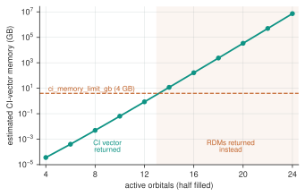

<!--
Copyright (c) 2026 Tobias Wolf
SPDX-License-Identifier: MIT

Adapted from skilledwolf/alpsx (private repository), branch
agent/v3-execution-and-api-audit at d37e51227,
python/qdk-chemistry-alps/docs/how-to/large-active-spaces.md. Changes: the
classic calculator's CI-vector estimate (1 kB per determinant) replaces the
MPS reconstruction workspace; the experimental mps container mode is not
carried over, and the MPS that pyalps returns is pointed to instead; output
and figure re-measured.
-->

# Work past the CI limit

The DMRG state can stay affordable when a configuration-interaction (CI) vector on every determinant of the sector would exceed memory. That depends on the model and the number of kept states; DMRG is not cheap for every large system. This guide explains how `alps_classic_dmrg` handles the CI-vector limit.

## The problem, concretely

The CI vector has one amplitude per determinant. Near half filling, the determinant count grows exponentially with the orbital count even when the DMRG state stays affordable. The calculator estimates the memory of the returned `StateVectorContainer` at 1 kB per determinant: about 460 B measured for qdk-chemistry's own determinant objects, plus the engine's arrays.

| Orbitals (half filled) | Determinants | Estimated CI memory |
| --- | --- | --- |
| 8 | 4 900 | 4.9 MB |
| 10 | 63 504 | 64 MB |
| 12 | 853 776 | 0.85 GB |
| 14 | 11 778 624 | 12 GB |



Estimated CI-vector memory against active-space size, with the default `ci_memory_limit_gb` of 4. The figure estimates memory, not DMRG runtime or convergence. Past the limit, the calculator returns RDMs when qdk-chemistry provides `RdmContainer`.

At 14 orbitals the raw float64 amplitudes take about 94 MB, but qdk-chemistry's determinant objects about 12 GB. At 12 orbitals the engine reconstructs the vector in 0.35 s, while building the `StateVectorContainer` takes 2.4 s, 2.1 s of it in qdk-chemistry's own objects: the calculator then takes 5.8 s, against 2.9 s with `wavefunction_container="rdm"`.

RDMs suffice for many downstream energy and orbital calculations. They do not replace coherent amplitudes for general circuit state preparation. A full spatial 2-RDM still contains $K^4$ entries for $K$ orbitals, so its storage and contraction costs also matter at larger sizes.

## Automatic fallback with an `RdmContainer`

[`examples/large_active_space.py`](../../examples/large_active_space.py) solves a 14-site Hubbard chain at half filling with 64 kept states and eight sweeps, under the default `wavefunction_container="auto"` (needs a qdk-chemistry that provides `RdmContainer`):

```text
container : rdm
energy    : -7.672344
method    : alps_classic_dmrg
kept states : 64
energy from stored RDMs : 7.11e-15  (difference)
natural occupations sum : 14.000000  (= electron count)
```

The run takes about 6 s and 270 MB on an Apple M-series laptop. The wavefunction came back as an `RdmContainer` rather than failing. It carries the active-space 1- and 2-RDMs and their spin blocks, the method name and metadata (`energy`, `max_bond_dim`, `sweeps`, `final_truncation_error`), and it serializes to JSON and HDF5 like any other qdk-chemistry wavefunction.

## Choosing explicitly

The `wavefunction_container` setting controls the whole behaviour:

- **`"auto"`** (default): return the CI vector while it fits `ci_memory_limit_gb`, otherwise an `RdmContainer`. The choice is made before the solve. Where qdk-chemistry lacks `RdmContainer` (released 2.2.1), a run past the limit raises `RuntimeError` naming the class before solving.
- **`"statevector"`**: always return the CI vector, and raise `MemoryError` past the limit. Use it when downstream code needs determinants and should fail rather than get something else.
- **`"rdm"`**: return an `RdmContainer` without a CI vector. This avoids the CI cost when only RDMs are needed.

```python
calc.settings().set("wavefunction_container", "rdm")
```

Raise `ci_memory_limit_gb` if you have the memory and want determinants anyway; the guard is a policy, not a hard limit.

The QDK calculator returns no matrix product state: qdk-chemistry 2.2.1 has no container for one. One level down, `pyalps.classic_dmrg.solve_molecular(h1, eri, n_alpha, n_beta, keep_mps=True)` returns the engine's final state as a `MatrixProductState` in `result.mps[0]`, whose `amplitude(states)` gives single determinants without the full vector; see the [pyalps README](../../../pyalps/README.md#models-exact-diagonalization-and-classic-dmrg).

## Verifying a result you cannot inspect directly

With no CI vector to look at, use the energy identity: the stored RDMs contracted with the integrals must reproduce the energy the solver reported,

$$
E = \sum_{pq} h_{pq}\, \gamma_{qp} + \tfrac{1}{2} \sum_{pqrs} (pq|rs)\, \Gamma_{pqrs} + E_\mathrm{core}.
$$

The tensors use the [PySCF index convention](../conventions.md#rdms). The example agrees to 7·10⁻¹⁵. Natural occupations summing to the electron count is a second, cheaper check.

Neither confirms *convergence*: both would pass on a converged and an under-converged state alike. For that, see [Converge a DMRG run](converging-dmrg.md).

## Reading occupations

Model orbital bases carry no spin axis, so the spin-resolved `get_active_orbital_occupations()` pair is unavailable by design. Use the symmetry-blocked accessor:

```python
occupations = wavefunction.active_orbital_occupations()
(label,) = occupations.extents()[0].keys()
natural = np.asarray(occupations.block([label])).ravel()
```

Without `RdmContainer`, `alps_classic_dmrg` still solves and exposes the RDMs through `make_rdms()`, but cannot return them as the wavefunction. See [Installation](../install.md#a-qdk-chemistry-that-provides-rdmcontainer).

## Next

- [Converge a DMRG run](converging-dmrg.md): the check this guide does not give you
- [Measure observables](observables.md): correlation functions at the same sizes
