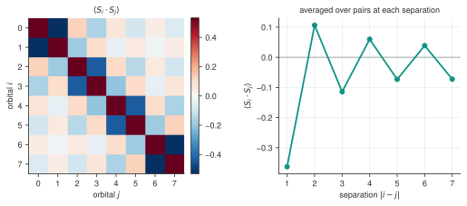

<!--
Copyright (c) 2026 Tobias Wolf
SPDX-License-Identifier: MIT

Adapted from skilledwolf/alpsx (private repository), branch
agent/v3-execution-and-api-audit at d37e51227,
python/qdk-chemistry-alps/docs/how-to/observables.md. Changes: the classic
calculator derives its measurements from the RDMs of the final sweep instead
of contracting an MPS; its operator set and the observables hook for other
operators replace alpsx's callables; figure and output re-measured.
-->

# Measure observables

`alps_classic_dmrg` measures every element of the one- and two-particle reduced density matrices (RDMs), by spin block, in its final sweep. Occupations, correlation functions and $\langle\mathbf S_i\cdot\mathbf S_j\rangle$ are derived from them, so they do not need the configuration-interaction (CI) vector and stay affordable beyond the [CI-vector limit](large-active-spaces.md). The calculator keeps no DMRG state after the run: everything comes from that final sweep. Check [solver convergence](converging-dmrg.md) separately.

## Everything at once

After [setup](../install.md), run from the **ALPS repository root**:

```bash
python python/qdk-chemistry-alps/examples/observables.py
```

[`examples/observables.py`](../../examples/observables.py) solves a six-site Hubbard chain at half filling and reads:

```python
occupations = np.asarray(calc.measure_local("n")).real
density = np.asarray(calc.measure_correlations("n")).real
spin = np.asarray(calc.spin_spin_correlations()).real
dm1, dm2 = calc.make_rdms()
```

```text
energy            : -3.092565
occupations       : [1. 1. 1. 1. 1. 1.]
trace             : 6.000000  (= electron count)
<S_i.S_j> nearest : [-0.5371 -0.1833 -0.4622 -0.1833 -0.5371]
mean              : -0.3806  (negative = antiferromagnetic)
occupations vs 1-RDM diagonal : 0.00e+00
<n_i n_j> vs 2-RDM            : 2.22e-16
```



Spin-spin correlations on an eight-site Hubbard chain at half filling. The sign alternates with separation and its magnitude decays with distance. These are antiferromagnetic correlations in a finite chain, not evidence of long-range order.

The last two lines of the output check index conventions: the measurements are read from the same RDMs. The test suite compares the measurements and the RDMs with independent references (`pyalps.ed`, PySCF FCI and MACIS).

## What you can measure

`measure_local` takes `n`, `n_up`, `n_dn`, `Sz` and `n_updn` (double occupancy). `measure_correlations` takes the number-type operators `n`, `n_up`, `n_dn` and `Sz` in any combination, or one of the ladder operators `c_up`, `c_dn`, `Sp` and `Sm` on both sides:

```python
occupations = calc.measure_local("n")            # <n_i>
double = calc.measure_local("n_updn")            # <n_i,up n_i,dn>
density_spin = calc.measure_correlations("n", "Sz")  # <n_i Sz_j>
c_up = calc.measure_correlations("c_up")         # <c+_{i,up} c_{j,up}>
```

Fermionic operators carry their Jordan–Wigner strings, so `measure_correlations("c_up")` gives the spin-up one-particle density matrix rather than a string-free approximation to it. This correlation matrix has the creation operator on the **first** index. The PySCF 1-RDM convention below has it on the **second** index: the spin-up contribution to `dm1` is `c_up.T`, not `c_up`.

For other operators, set `calc.observables` to a dict of `pyalps.models` term sums on `SpinfulFermion()` sites (site `p` is orbital `p`, at most four sites per product) **before** `run()`, and read the values from `calc.last_result.observables`:

```python
from pyalps import models

fs = models.SpinfulFermion()
calc.observables = {"Sz0 Sz1": fs.Sz(0) * fs.Sz(1)}
energy, _ = calc.run(hamiltonian, 3, 3)
print(calc.last_result.observables["Sz0 Sz1"])
```

## The dagger is on the first index

`measure_correlations(op_i, op_j)` returns

$$
C_{ij} = \langle O_i^\dagger O_j \rangle.
$$

The conjugation matters for non-Hermitian operators: since $(S^+)^\dagger = S^-$, `measure_correlations("Sp")` gives $\langle S^-_i S^+_j \rangle$. For Hermitian operators like `n` and `Sz`, conjugation leaves the operator unchanged. The full spin-spin correlation is

$$
\langle \mathbf{S}_i \cdot \mathbf{S}_j \rangle = C_{ij}(S^z) + \tfrac{1}{2}\left[C_{ij}(S^+) + C_{ij}(S^-)\right].
$$

Use `spin_spin_correlations()` to compute this combination; its sum over all pairs is $\langle S^2\rangle$.

## RDMs for a downstream driver

```python
dm1, dm2 = calc.make_rdms()
```

These are spin-traced one- and two-particle reduced density matrices in the PySCF `make_rdm12` convention, so they contract with chemist integrals directly:

$$
E = \sum_{pq} h_{pq}\, \gamma_{qp} + \tfrac{1}{2} \sum_{pqrs} (pq|rs)\, \Gamma_{pqrs} + E_\mathrm{core}.
$$

Here $\gamma_{pq}=\sum_\sigma\langle c^\dagger_{q\sigma}c_{p\sigma}\rangle$; the reversed indices in the one-body contraction are intentional. The [conventions guide](../conventions.md#rdms) defines both tensors and the spin blocks. This identity checks measurement consistency for the computed state, not ground-state convergence; the [large active space guide](large-active-spaces.md) uses it as such a check.

All of these read the most recent `run()`. Calling them before a run raises `RuntimeError` rather than returning zeros.

## Next

- [Work past the CI limit](large-active-spaces.md): keep measuring without a CI vector
- [Conventions](../conventions.md): the full set of index and sign conventions
